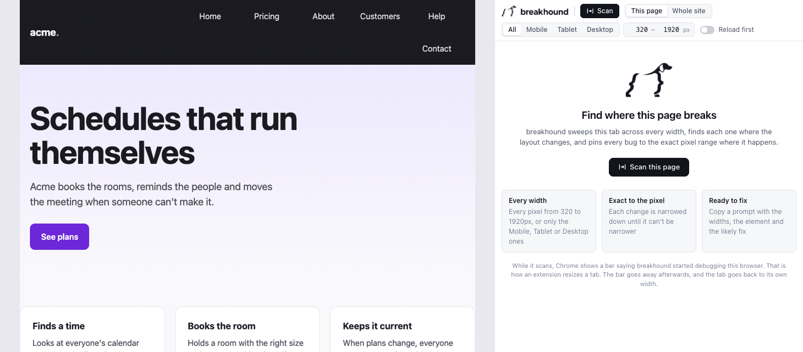

<div class="demo">



</div>

```bash
npx @seybel/breakhound
```

Run it in your project folder. No config: it finds your framework, your dev server and every route, and starts the server if it isn't running.

<style>
.demo img { border-radius: 12px; border: 1px solid var(--vp-c-divider); margin: 8px 0 24px; }
</style>
